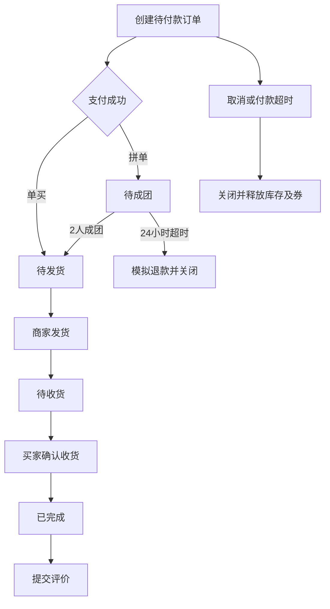
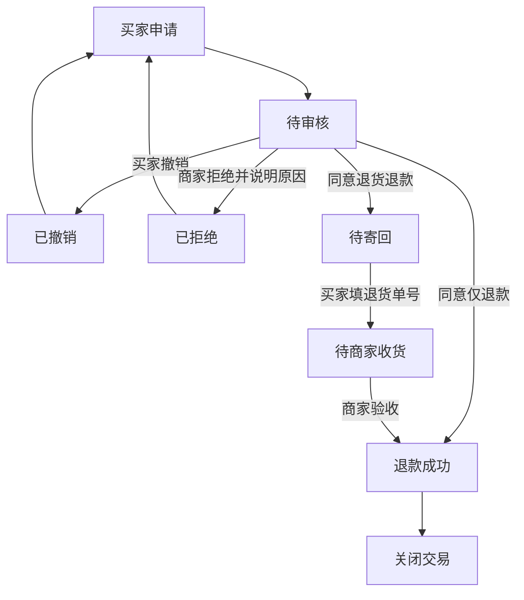

# 02 · 流程、数据与实现设计

## 一、实现步骤

1. 先确定订单主状态、支付状态和售后状态，不先堆页面。
2. 约定SKU、金额、库存预占、优惠券及地址快照结构。
3. 实现纯函数报价、创建订单、动作权限、状态转换、超时处理。
4. 使用mockdata.json为每个阶段准备可操作样本。
5. 实现本地存储适配层：加载、深拷贝事务、先保存后提交界面。
6. 构建列表、确认订单、详情、角色切换、演示控制台。
7. 用自动化测试验证闭环与边界，用浏览器验证实际表单与刷新行为。

## 二、交易状态机

退款成功可以从已支付的各阶段关闭交易，发起申请本身不改主状态。支付30分钟/拼单24小时在创建和支付时写入明确deadline，不依靠格式化时间比较。

## 三、售后状态机

pending、returning、returned期间为活动售后，禁发货、禁确认收货、禁修改地址、禁再次申请及评价。已拒绝或撤销后恢复原订单操作。正在待成团的订单即使有待审核售后，达到成团截止时间仍走成团失败退款，旧申请存入历史。

## 四、实体与关键字段

| 对象 | 字段 | 说明 |
|---|---|---|
| Product | id, title, shop, category, icon, color, skus | 商品目录与示意图 |
| SKU | id, name, price, groupPrice, stock | 金额为分；stock为可售库存，不含已预占数量 |
| Coupon | id, name, min, amount, orderId | orderId非空表示被占用，退款/取消后按演示政策返还 |
| Order | id, productId, skuId, title, spec, qty | 商品名称和规格均为快照 |
| Order金额 | unitPrice, subtotal, shipping, discount, total | subtotal=unitPrice×qty；total=max(0,subtotal-discount)+shipping |
| Order履约 | status, payment, paymentMethod, group | 主状态、支付方式、成团计数与截止时间 |
| Order地址 | address{name,phone,detail}, note | 与地址簿解耦 |
| Order时间 | createdAt, payDeadline, paidAt, shippedAt, completedAt | JS毫秒时间戳 |
| Order审计 | events[{time,text,actor}] | 最新操作在前，不含敏感支付凭证 |
| Logistics | carrier, tracking, logistics[{time,text}] | 发货及物流轨迹 |
| AfterSale | id,status,type,reason,amount,createdAt,completedAt | 当前售后；afterSales保存历史 |
| Review | rating,content,time | 每单一份，成功提交后不可再次评价 |
| 本地封套 | version,db,offset | 存储结构版本、业务数据、模拟时间偏移 |

public/mockdata.json中的时间是相对首次加载时刻的偏移，单位毫秒。例如payDeadline=1500000表示25分钟后过期。hydrate只对指定时间字段进行转换；导出的JSON使用绝对时间，**不能直接覆盖种子文件**。如要手动改种子，按照原始相对时间结构修改，并在控制台恢复初始数据。

种子库存已视为扣除示例订单占用后的可售数，不会在hydrate时再扣一次。新订单创建时才执行库存扣减。

## 五、动作矩阵

| 动作 | 角色 | 前置条件 | 结果 |
|---|---|---|---|
| 创建 | 买家页面 | 地址、SKU、数量、库存、券有效 | 待付款，扣减可售库存，券绑定订单 |
| 支付 | buyer | 待付款且截止时间未到 | paid；单买待发货，拼单待成团 |
| 取消 | buyer | 待付款，原因必填 | closed，释放库存与券 |
| 改地址 | buyer | 待付款/待成团/待发货且无活动售后 | 更新订单地址快照 |
| 参团 | simulator | 待成团且无活动售后 | 成团成功，待发货 |
| 发货 | merchant | 待发货且无活动售后 | 写入快递、待收货 |
| 物流推进 | simulator | 待收货且无活动售后 | 增加轨迹，最多4个后续节点 |
| 确认收货 | buyer | 待收货且无活动售后 | completed，记录完成时间 |
| 评价 | buyer | 已完成、未评价、无活动售后 | 保存评分内容 |
| 售后申请 | buyer | 已付款未关闭、无活动售后、期限内 | pending，不改主状态 |
| 同意/拒绝 | merchant | pending | 退款或待寄回 / rejected |
| 寄回 | buyer | returning，合法快递信息 | returned |
| 验收退款 | merchant | returned | 全额退款，关闭交易 |

权限在领域转换函数再次检查，不仅靠隐藏按钮。但这是演示规则检查，不是真实安全边界；本地代码可被用户修改。

## 六、库存与优惠券

创建时stock减数量，避免单标签页连下多单超卖。未支付取消或超时、未发货退款、成团失败均恢复库存。已发货仅退款不恢复商品库存；退货验收退款按“商品验收合格可重新销售”的演示假设恢复库存。真实系统应进退货待检库存，质检后再决定可售/残次。

stockReleased标记避免重复恢复；退款完成后的二次退款也被状态校验拒绝。优惠券在本项目全额退款/关闭后返还；支付后直到退款前仍占用，不可以在其他新单重复使用。真实平台优惠券是否可退、是否过期应单独建规则。

## 七、分层与API替换点

- views：负责展示、过滤、填写表单和导航；不直接加减库存。
- ActionPanel：按availableActions生成操作；弹窗提交调用act。
- domain/orders.js：报价、状态机、校验、超时与日志，纯JS可单测。
- services/store.js：读取种子、localStorage、数据提交；供未来HTTP接口替换。

store.transact对当前DB深拷贝，在副本执行操作，再保存localStorage，成功后替换响应式数据。如果配额或权限导致保存失败，界面不提交新状态，表单显示错误。初次存储不可用则显示加载错误；本项目不在存储失败时伪装成已持久保存。

未来接口建议（当前并没有实现HTTP服务）：

| 方法 | 路径 | 内容 |
|---|---|---|
| GET | /products, /orders, /orders/:id | 分页查询与详情 |
| POST | /orders/quote | 后端重新核价 |
| POST | /orders | idempotencyKey + SKU/数量/地址/券 |
| POST | /orders/:id/payment-intents | 创建支付单，不能相信前端成功回调 |
| POST | /payment/webhook | 验签、去重、订单支付入账 |
| POST | /orders/:id/ship | 校验店铺归属、版本、发货字段 |
| POST | /orders/:id/receive | 买家归属校验与收货 |
| POST | /orders/:id/after-sales | 申请售后 |
| POST | /after-sales/:id/approve、reject、return、receive | 独立售后动作 |
| POST | /orders/:id/reviews | 一单一次评价 |

## 八、前端实现细节

Hash路由支持刷新详情及前进后退；路由未匹配回到列表；不存在的订单显示空态。金额所有运算采用整数分，展示才除100。文本使用Vue默认转义，不使用v-html。对话框支持Escape、遮罩关闭、焦点约束与关闭后返回触发按钮。请求采用fetch读取同源JSON，无第三方运行时网络资源。

本项目没有网络延迟模拟、失败率注入或HTTP重试，支付和退款提交立即完成。因此它验证的是本地业务闭环，不验证支付网关、服务端事务和跨进程幂等。
